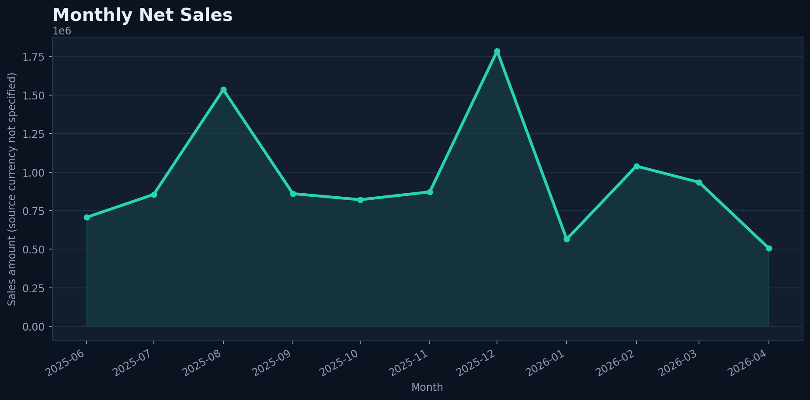
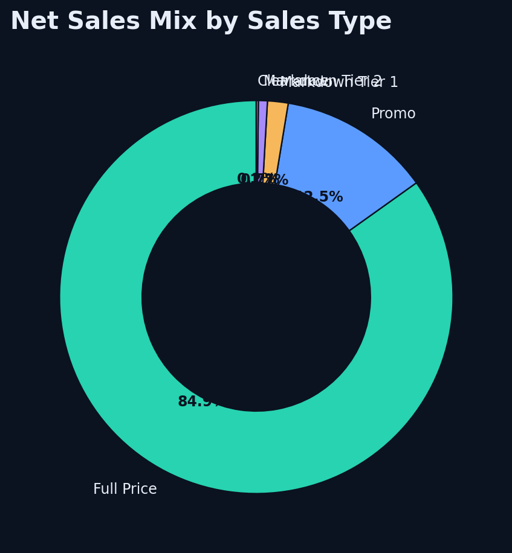
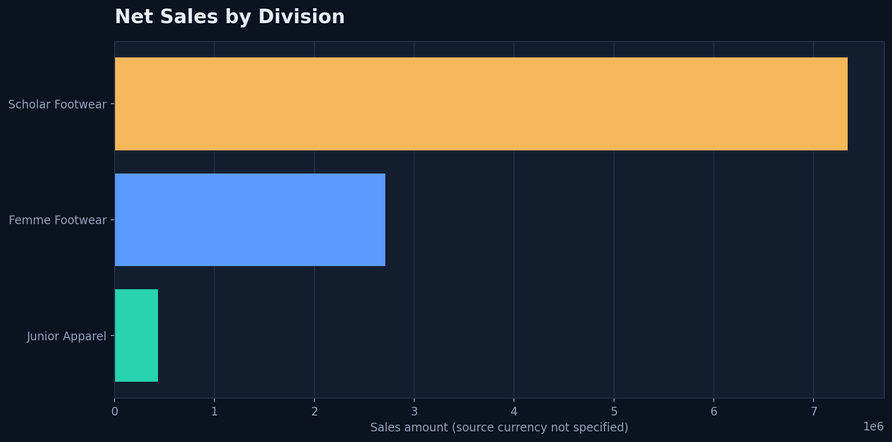
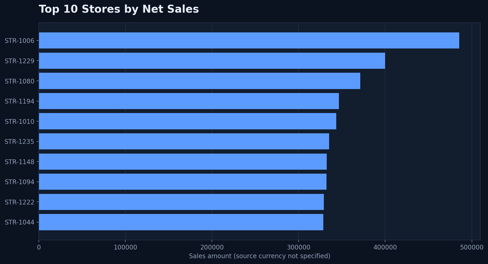

# RetailPulse — Power BI Report Build Guide

This guide recreates the RetailPulse analytics experience in **Power BI Desktop**. It explains the report pages, data model, DAX measures, visual choices, slicers, formatting and the exact steps to build each visual.

> **Dataset used for the examples:** Retail Transactions and Stocks Data, Jimmy Smith, Mendeley Data, Version 1, CC BY 4.0. The figures in the chart previews below are calculated from the downloaded source sales file included in the supplied project archive. The raw dataset itself is intentionally not included in the GitHub release. Source observation dates in this copy: **1 June 2025 to 24 April 2026**. This is not a full FY 2026–27 dataset. The source currency is not identified in the available columns, so visuals should say “Sales amount” rather than adding an assumed currency symbol.

## 1. What you will build

Create a six-page Power BI report with a consistent RetailPulse design:

| Page | Purpose | Main visuals |
|---|---|---|
| 1. Executive Overview | One-screen business summary | KPI cards, monthly sales line, sales-type donut, division bar |
| 2. Sales Performance | Understand trend and sales mix | Line chart, clustered/stacked columns, matrix, weekday bar |
| 3. Product Intelligence | Find product/category contribution | Ranked bar, treemap, product matrix, Pareto-style combo chart |
| 4. Store Performance | Compare store results | Top-N bar, sales vs profit scatter, store matrix |
| 5. Inventory Intelligence | Review stock position | On-hand bar, store-category matrix/heatmap, stock status breakdown |
| 6. Data Quality | Make data reliability visible | Quality KPI cards, issue counts, data-quality detail table |

Use the same page background, typography, accent colours, title placement, slicers and spacing on all pages.

## 2. Source files and Power BI import

Download the two original CSV files from the [Mendeley dataset page](https://data.mendeley.com/datasets/27x8mjm8k4/1):

- Sales: `retail_sales_ml_apl.csv`
- Inventory: `retail_inventory_ml_apl.csv`

In Power BI Desktop:

1. Select **Home → Get data → Text/CSV**.
2. Choose the sales CSV and select **Transform Data**.
3. Rename the query to `FactSales`.
4. Repeat for inventory and rename it `FactInventory`.
5. In Power Query, check data types before selecting **Close & Apply**.

### Important source fields

| Power BI field name | Original CSV header | Data type |
|---|---|---|
| Date | Transaction Date | Date |
| Sales Type | Sales Type | Text |
| Is Return | Is Return | Whole number / True-False |
| Return Reason | Reason of Return | Text |
| Supplier | Supplier | Text |
| SKU ID | Product No | Text |
| Product Description | Product Description | Text |
| Division | Product Division | Text |
| Category | Product Category | Text |
| Subcategory | Product Subcategory | Text |
| Segment | Product Segment | Text |
| Store ID | Store | Text |
| Sales Channel | Sales Channel | Text |
| Quantity | Qty Sold | Decimal number |
| Sales Amount | Sales Amount | Decimal number |
| COGS | Cogs | Decimal number |
| Transaction Count | Number of Transactions | Whole number |

Inventory fields include `Start Date`, `End Date`, `Stock Status`, `Store Type`, `Qty on hand`, `Stocks Selling Amount`, `Cost of Stocks`, `Stock Unit Selling Price` and `Stock Unit Cost Price`, plus the product/store descriptors.

**Do not convert IDs to numbers.** Store and product identifiers are categorical keys, not measures.

### Power Query clean-up

For both queries:

1. Set date fields to **Date** (not Date/Time) if the time portion is always midnight.
2. Set quantity, sales, cost and stock measures to Decimal Number or Whole Number as appropriate.
3. Trim and clean text fields: select text columns → **Transform → Format → Trim**, then **Clean**.
4. Replace empty product hierarchy labels with `Unknown` only if that is the intended reporting treatment.
5. Do not delete negative sales or quantity rows automatically. The source contains negative rows and an `Is Return` flag; inspect them as return-related records.
6. Keep the original source columns available for traceability.

For inventory, `End Date` can contain a far-future sentinel date. If it is not needed for the report, keep it as text or remove it from the report model rather than forcing it into a date type that may exceed Power BI's supported range.

## 3. Build a clean star schema

Do not directly join `FactSales` to `FactInventory`. Both are fact tables and a direct join can multiply rows and inflate totals.

Create three shared dimensions:

- `DimDate`
- `DimProduct`
- `DimStore`

### Date table (DAX)

Select **Modeling → New table** and add:

```DAX
DimDate =
VAR AllFactDates =
    UNION (
        SELECTCOLUMNS ( FactSales, "FactDate", FactSales[Date] ),
        SELECTCOLUMNS ( FactInventory, "FactDate", FactInventory[Start Date] )
    )
VAR MinDate = MINX ( AllFactDates, [FactDate] )
VAR MaxDate = MAXX ( AllFactDates, [FactDate] )
RETURN
ADDCOLUMNS (
    CALENDAR ( MinDate, MaxDate ),
    "Year", YEAR ( [Date] ),
    "Month Number", MONTH ( [Date] ),
    "Month", FORMAT ( [Date], "MMM" ),
    "Year Month", FORMAT ( [Date], "YYYY-MM" ),
    "Quarter", "Q" & FORMAT ( [Date], "Q" ),
    "Weekday", FORMAT ( [Date], "ddd" ),
    "Weekday Number", WEEKDAY ( [Date], 2 )
)
```

Then select `DimDate` → **Table tools → Mark as date table** → choose `DimDate[Date]`. Sort `DimDate[Month]` by `DimDate[Month Number]`.

### Product dimension (DAX)

```DAX
DimProduct =
DISTINCT (
    SELECTCOLUMNS (
        FactSales,
        "SKU ID", FactSales[SKU ID],
        "Product Description", FactSales[Product Description],
        "Division", FactSales[Division],
        "Category", FactSales[Category],
        "Subcategory", FactSales[Subcategory],
        "Segment", FactSales[Segment]
    )
)
```

### Store dimension (DAX)

```DAX
DimStore =
DISTINCT (
    SELECTCOLUMNS (
        FactSales,
        "Store ID", FactSales[Store ID]
    )
)
```

If inventory contains store or product keys that do not exist in sales, build the dimensions in Power Query from a **distinct append/union of the keys from both fact queries** instead of using the DAX examples above.

### Relationships

In **Model view**, create these one-to-many, single-direction relationships:

- `DimDate[Date]` → `FactSales[Date]`
- `DimDate[Date]` → `FactInventory[Start Date]` (use the inventory snapshot date field selected for reporting)
- `DimProduct[SKU ID]` → `FactSales[SKU ID]`
- `DimProduct[SKU ID]` → `FactInventory[Product No]`
- `DimStore[Store ID]` → `FactSales[Store ID]`
- `DimStore[Store ID]` → `FactInventory[Store]`

Set the dimension side to **1**, fact side to **\***, and cross-filter direction to **Single**. Check for unmatched keys before publishing.

## 4. Core DAX measures

Create a dedicated table named `Measures` if you want to keep measures organised: **Home → Enter data**, create one blank column, name the table `Measures`, then hide the blank column.

```DAX
Net Sales =
SUM ( FactSales[Sales Amount] )

Net Units =
SUM ( FactSales[Quantity] )

Source Transaction Count =
SUM ( FactSales[Transaction Count] )

COGS =
SUM ( FactSales[COGS] )

Gross Profit =
SUMX (
    FactSales,
    FactSales[Sales Amount] - FactSales[COGS]
)

Gross Margin % =
DIVIDE ( [Gross Profit], [Net Sales] )

Average Selling Price =
DIVIDE ( [Net Sales], [Net Units] )

Store Count =
DISTINCTCOUNT ( DimStore[Store ID] )

SKU Count =
DISTINCTCOUNT ( DimProduct[SKU ID] )

Sales Rows =
COUNTROWS ( FactSales )

Return Rows =
CALCULATE (
    COUNTROWS ( FactSales ),
    FactSales[Is Return] = 1
)

Return Row % =
DIVIDE ( [Return Rows], [Sales Rows] )

Negative Sales Rows =
CALCULATE (
    COUNTROWS ( FactSales ),
    FactSales[Sales Amount] < 0
)

Negative Quantity Rows =
CALCULATE (
    COUNTROWS ( FactSales ),
    FactSales[Quantity] < 0
)

On-hand Units =
SUM ( FactInventory[Qty on hand] )
```

**Measure validation before presenting results:**

- The ETL calculates row-level gross profit as `Sales Amount - Cogs`. Reconcile the DAX total with the ETL output.
- Confirm the source's COGS sign convention for return rows. Do not change signs without evidence.
- `Source Transaction Count` uses the provided `Number of Transactions` field. Validate whether it is additive at the row grain before using it as a headline KPI.
- `On-hand Units` is a stock snapshot. Filter to a specific/latest inventory date when showing a current stock position; do not sum multiple snapshots across dates and call it current inventory.
- Negative sales/quantity rows should be described as negative or return-related rows until their exact business meaning is confirmed.

## 5. Page 1 — Executive Overview

**Layout**

- Top: page title and short description.
- Row 1: five KPI cards — Net Sales, Gross Profit, Gross Margin %, Net Units, Store Count.
- Row 2: Monthly Net Sales line chart (wide) and Sales Mix by Sales Type donut (narrow).
- Row 3: Net Sales by Division bar chart and a compact Top 10 Stores table/bar.
- Place global slicers in a slim horizontal strip or a collapsible filter panel.

### Visual A — KPI cards

1. Add a **Card** visual.
2. Drag `[Net Sales]` into **Data**.
3. Repeat for `[Gross Profit]`, `[Gross Margin %]`, `[Net Units]`, `[Store Count]`.
4. Format Gross Margin as Percentage (1 decimal); format other measures with display units and thousands separators.
5. Use the same card height and width.

### Visual B — Monthly sales trend



1. Add a **Line chart**.
2. X-axis: `DimDate[Year Month]`.
3. Y-axis: `[Net Sales]`.
4. Sort Year Month ascending.
5. Turn on markers; use a clear title and a subtle grid.
6. Use a tooltip containing `[Gross Profit]`, `[Net Units]` and `[Gross Margin %]`.

### Visual C — Sales mix by sales type



1. Add a **Donut chart**.
2. Legend: `FactSales[Sales Type]` (or a corresponding dimension field).
3. Values: `[Net Sales]`.
4. Turn on detail labels as percentage and category for this small number of groups.
5. Avoid donut charts for dozens of product categories; use a bar chart instead.

### Visual D — Net sales by division



1. Add a **Clustered bar chart**.
2. Y-axis: `DimProduct[Division]`.
3. X-axis: `[Net Sales]`.
4. Sort descending by `[Net Sales]`.
5. Turn on data labels if they do not crowd the visual.

## 6. Page 2 — Sales Performance

**Recommended visuals**

| Visual | Fields | Build steps |
|---|---|---|
| Monthly sales and profit | Axis: `DimDate[Year Month]`; Values: `[Net Sales]`, `[Gross Profit]` | Line chart; add both measures to Y-axis |
| Sales by type over time | Axis: `DimDate[Year Month]`; Legend: `FactSales[Sales Type]`; Values: `[Net Sales]` | Stacked column chart; use legend for mix |
| Weekday comparison | Axis: `DimDate[Weekday]`; Values: `[Net Sales]` | Clustered column; sort weekday by weekday number |
| Sales detail | Rows: Date, Store ID, Sales Type; Values: Net Sales, Net Units, Gross Profit | Matrix; enable subtotals and number formatting |

**Build the weekday chart:** add a clustered column chart, put `DimDate[Weekday]` on X-axis and `[Net Sales]` on Y-axis. In Model view, sort Weekday by Weekday Number so Monday–Sunday is chronological.

## 7. Page 3 — Product Intelligence

**Visual A — Category contribution**

1. Add a **Clustered bar chart**.
2. Y-axis: `DimProduct[Category]`.
3. X-axis: `[Net Sales]`.
4. Sort descending and apply a Top N filter if the category list is long.

**Visual B — Product hierarchy**


1. Add a **Treemap**.
2. Group: `DimProduct[Division]`, then `DimProduct[Category]`.
3. Values: `[Net Sales]`.
4. Use drill-down to move from division to category and subcategory.
5. Keep labels concise; use tooltips for the full product name.

**Visual C — SKU performance table**

- Rows: SKU ID, Product Description, Division, Category.
- Values: Net Sales, Net Units, Gross Profit, Gross Margin %.
- Sort by Net Sales descending.
- Add a Top N filter for the top 20 SKUs.

**Pareto analysis:** rank categories/SKUs by `[Net Sales]`, calculate a running total using a rank measure and divide by total sales. Use a Line and clustered column chart with sales bars and cumulative sales percentage line. Validate the ranking and cumulative calculation under slicers before publishing.

## 8. Page 4 — Store Performance



**Visual A — Top 10 stores**

1. Add a **Clustered bar chart**.
2. Y-axis: `DimStore[Store ID]`.
3. X-axis: `[Net Sales]`.
4. In Filters on this visual, select Store ID → **Filter type: Top N** → Top 10 → By value `[Net Sales]` → Apply filter.
5. Sort descending.

**Visual B — Sales vs profit**

1. Add a **Scatter chart**.
2. X-axis: `[Net Sales]`.
3. Y-axis: `[Gross Profit]`.
4. Details: `DimStore[Store ID]`.
5. Size: `[Net Units]`.
6. Tooltips: Gross Margin %, Store ID and Net Units.
7. Use the visual to identify stores that are outliers; investigate source coverage before explaining why.

**Visual C — Store scorecard matrix**

Rows: Store ID. Values: Net Sales, Gross Profit, Gross Margin %, Net Units, SKU Count. Apply conditional formatting to Net Sales and Gross Margin %.

## 9. Page 5 — Inventory Intelligence

**Visual A — On-hand units by division/category**

1. Add a clustered bar chart.
2. Axis: `DimProduct[Division]` or `DimProduct[Category]`.
3. Values: `[On-hand Units]`.
4. Add a date slicer based on the inventory snapshot date.
5. If the page is intended to show the latest stock only, create a latest-snapshot filter/measure and validate it against the source.

**Visual B — Store × category stock matrix**

1. Add a **Matrix** visual.
2. Rows: `DimStore[Store ID]`.
3. Columns: `DimProduct[Category]`.
4. Values: `[On-hand Units]`.
5. Under **Cell elements → Background color**, select conditional formatting using a colour scale.
6. Keep the row/column count manageable; use slicers to focus on a division or selected stores.

**Visual C — Stock status**

- Axis: `FactInventory[Stock Status]`.
- Values: `[On-hand Units]`.
- Use a bar chart unless the number of statuses is very small.

**Caution:** `Start Date` is the snapshot date used for the example model. Confirm the meaning and frequency of the inventory snapshots before calling a selected snapshot “current stock”.

## 10. Page 6 — Data Quality

Create cards for:

- Sales Rows
- Negative Sales Rows
- Negative Quantity Rows
- Return Rows
- Missing Date Count
- Missing Store Count
- Missing SKU Count

For missing-key counts, use Power Query profiling or explicit DAX calculated measures. Example:

```DAX
Missing Store Rows =
COUNTROWS (
    FILTER (
        FactSales,
        ISBLANK ( FactSales[Store ID] )
            || TRIM ( FactSales[Store ID] ) = ""
    )
)
```

Repeat for SKU ID and Date. Add a detail table with Date, Store ID, SKU ID, Sales Type, Is Return, Quantity and Sales Amount. Use conditional formatting to highlight negative values.

Do not treat every negative row as an error. In this source, negative quantity and sales rows are part of the source profile and may represent returns. The quality page should flag them for investigation, not delete them.

## 11. Global slicers and interactions

Recommended global slicers:

- Date range (`DimDate[Date]`) — Between
- Store (`DimStore[Store ID]`) — Dropdown with search
- Division (`DimProduct[Division]`) — Dropdown
- Category (`DimProduct[Category]`) — Dropdown with search
- Sales Type (`FactSales[Sales Type]`) — Dropdown

To make slicers apply across pages:

1. Select a slicer.
2. Choose **View → Sync slicers**.
3. Tick **Sync** for all report pages.
4. Tick **Visible** where the slicer should appear.
5. Repeat for each slicer.

For visual interactions:

1. Select a chart.
2. Choose **Format → Edit interactions**.
3. For each other visual, select Filter, Highlight or None as appropriate.
4. Test that selecting a category updates KPIs and related charts consistently.

Use a Reset Filters bookmark:

1. Set all slicers to the default state.
2. Select **View → Bookmarks → Add**.
3. Rename it `Reset filters`.
4. In bookmark options, ensure **Data** is selected.
5. Add a button and set **Action → Bookmark → Reset filters**.

## 12. Theme and layout standards

Suggested RetailPulse Power BI theme:

| Token | Colour | Use |
|---|---|---|
| Navy | `#0B1220` | Dark page background |
| Panel | `#121D2E` | Visual backgrounds |
| Teal | `#27D3B0` | Primary accent / sales |
| Blue | `#5B9BFF` | Secondary series |
| Text | `#E8EEF7` | Dark-mode text |
| Muted | `#91A2B8` | Secondary labels |
| Border | `#26364D` | Dividers and card borders |

For a light report theme, use a white or `#F3F6FA` page background, dark navy text (`#172437`), light grey-blue panels (`#FFFFFF` / `#EDF2F8`) and a darker teal accent (`#087F70`). Never use pale grey text on white charts.

Recommended layout rules:

- Use a 16:9 report canvas.
- Align all visuals to a grid; keep 16–24 px visual gaps.
- Keep page titles at the same position.
- Use 4–5 KPI cards per row maximum.
- Avoid legends with dozens of categories; use ranked bars and Top N filters.
- Use consistent number formats and units across pages.
- Add meaningful alt text to visuals where possible.
- Test at 100% zoom and in Power BI Service.

## 13. Publish and share

1. Save the `.pbix` file.
2. Select **Home → Publish**.
3. Choose the correct Power BI workspace.
4. Open the report in Power BI Service and test slicers, bookmarks and interactions.
5. Confirm the sharing permissions and licensing before distributing the report link.
6. Do not publish the raw source files or expose credentials in the report.

## 14. Troubleshooting

| Issue | What to check |
|---|---|
| Sales total is too high | Check relationship cardinality; do not join fact tables directly |
| Month order is alphabetical | Sort Month by Month Number or use Year Month |
| Store slicer does not filter inventory | Check DimStore relationship to FactInventory |
| Category chart has many tiny labels | Use Top N, hierarchy drill-down or a treemap |
| Gross profit differs from Streamlit | Compare row-level Sales Amount − Cogs, return signs and filters |
| Inventory appears inflated | Ensure one snapshot date is selected; do not sum multiple snapshots as current stock |
| Return rows disappear | Check that negative values were not filtered out in Power Query |

## 15. Dataset attribution

Smith, Jimmy (2026). *Retail Transactions and Stocks Data*, Version 1. Mendeley Data. https://doi.org/10.17632/27x8mjm8k4.1. Licensed under CC BY 4.0. Retain attribution and check the dataset record for updated terms.
